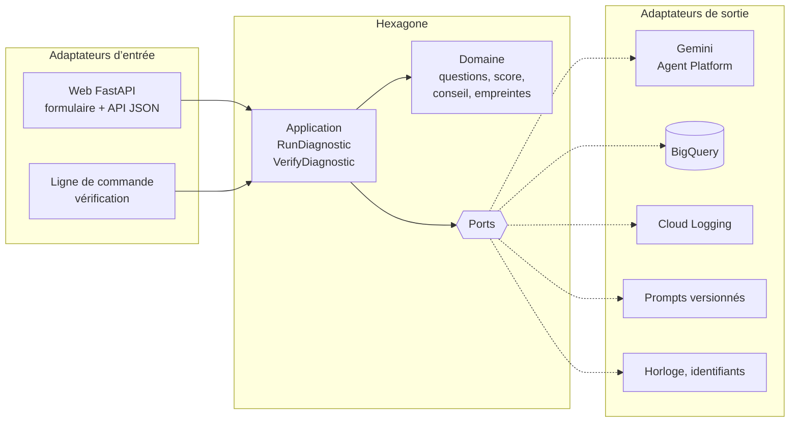

# Diagnostic de maturité IA

Une application web qui dit à un dirigeant de PME où l’IA et l’automatisation peuvent l’aider en premier. Il répond à dix questions et obtient un score de maturité sur 100, plus trois priorités chiffrées, chacune avec un niveau de confiance et une justification.

Projet vitrine d’Agence Wengraf : une application IA sur Google Cloud, en architecture hexagonale, auditable de bout en bout.

## Architecture hexagonale

Le cœur (domaine et cas d’usage) ne connaît ni FastAPI, ni Gemini, ni BigQuery. Il déclare des **ports**, et des **adaptateurs** les implémentent. Changer de modèle, de base de données ou d’interface ne touche pas au cœur.



```
app/
├── domain/                 Règles métier, bibliothèque standard uniquement
│   ├── model.py            Diagnostic, Score, Advice, Recommendation…
│   ├── questions.py        Les 10 questions et leur validation
│   ├── submission.py       Soumission recevable : réponses, accord, e-mail
│   ├── scoring.py          Grille de score fixe
│   ├── advice.py           Contrôle de la sortie du modèle
│   └── fingerprint.py      Empreintes SHA-256 et vérification
├── application/            Cas d’usage, dépend du domaine seulement
│   ├── ports.py            AdviceGenerator, DiagnosticRepository, PromptProvider,
│   │                       EventPublisher, Clock, IdGenerator
│   ├── run_diagnostic.py   Produire un diagnostic tracé
│   └── verify_diagnostic.py
├── adapters/
│   ├── inbound/web/        FastAPI : routes HTML, API JSON, gabarits
│   ├── inbound/cli/        Vérification d’intégrité
│   └── outbound/           Gemini, faux modèle, BigQuery, mémoire,
│                           prompts, logs JSON, horloge
├── bootstrap.py            Racine de composition : choisit les adaptateurs
├── main.py                 Point d’entrée web
└── verify.py               Point d’entrée de vérification
```

| Port | Adaptateur Google Cloud | Adaptateur local |
|---|---|---|
| `AdviceGenerator` | `GeminiAdviceGenerator` | `FakeAdviceGenerator` |
| `DiagnosticRepository` | `BigQueryDiagnosticRepository` | `InMemoryDiagnosticRepository` |
| `EventPublisher` | `LoggingEventPublisher` (Cloud Logging) | doublure de test |
| `PromptProvider` | `FilePromptProvider` | idem |
| `Clock`, `IdGenerator` | `UtcClock`, `UuidIdGenerator` | horloge fixe, identifiants séquentiels |

**La règle de dépendance est testée.** `tests/test_architecture.py` lit les imports de chaque fichier et fait échouer le build si le domaine importe l’application, un framework ou un SDK, ou si un adaptateur d’entrée importe un adaptateur de sortie.

## Travailler avec Claude Code

| Fichier | Rôle |
|---|---|
| `AGENTS.md` | Règles communes à tous les assistants de code (Claude Code, Cursor, Codex). |
| `CLAUDE.md` | Importe `AGENTS.md` et ajoute les consignes propres à Claude Code. |
| `CLAUDE.local.md` | Préférences personnelles, non versionnées. |
| `MAP.md` | Quels fichiers toucher pour chaque changement. Un test vérifie qu’elle est à jour. |
| `SPEC.md` | Ce que l’application doit faire, et ce qu’elle ne fait pas. |
| `PLAN.md` | Les étapes, cochées au fur et à mesure. |
| `.claude/settings.json` | Permissions (lecture libre, actions cloud validées, suppressions interdites) et hook qui relance les tests. |
| `.claude/rules/` | Règles chargées seulement quand Claude travaille dans le dossier concerné. |
| `.claude/agents/architecture-reviewer.md` | Sous-agent relecteur, avec sa propre mémoire de projet. |
| `.claude/skills/` | Procédures pour ajouter un port ou une version de prompt. |
| `.worktreeinclude` | Copie `.env` dans les sessions parallèles. |

## Services Google Cloud

| Service | Rôle |
|---|---|
| Cloud Run | Héberge l’application, descend à zéro instance quand personne ne l’utilise. |
| Gemini (Agent Platform, anciennement Vertex AI) | Rédige la synthèse et les trois recommandations, au format JSON imposé. |
| BigQuery | Stocke chaque diagnostic avec son contexte complet et ses empreintes. |
| Cloud Logging | Reçoit les événements en JSON, exportés vers BigQuery par un sink. |
| Cloud Build | Teste, construit et déploie à chaque push sur `main`. |
| Artifact Registry | Stocke les images Docker. |

## Choix de conception

**Le score ne vient pas du modèle.** Il est calculé par une grille fixe (`domain/scoring.py`), donc reproductible et explicable ligne par ligne. Le modèle ne fait que rédiger la synthèse et les recommandations.

**Aucun résultat sans trace.** Si l’enregistrement échoue, le cas d’usage lève `DiagnosticNotRecorded` et rien n’est affiché.

**Trois empreintes SHA-256 par diagnostic.** Une pour les réponses, une pour ce qui a été montré, une pour l’ensemble (référence, date, prompt, modèle). `python -m app.verify <référence>` les recalcule.

**La sortie du modèle n’est jamais prise telle quelle.** L’adaptateur Gemini impose un schéma JSON et le traduit en objets du domaine (couche anticorruption), puis `domain/advice.py` applique les règles : trois recommandations au plus, confiance entre 0 et 1, rejet si incomplet.

**Les réponses sont des données, pas des consignes.** Elles sont encadrées par des balises et le prompt demande d’ignorer toute instruction qu’elles contiendraient.

**Aucune clé API, aucune donnée personnelle dans les logs.** L’application s’authentifie avec son compte de service. L’e-mail facultatif est stocké dans BigQuery mais n’apparaît jamais dans les événements, et un test le vérifie.

## Lancer en local

Sans aucun service Google, avec le faux modèle et le stockage en mémoire :

```bash
python -m venv .venv && source .venv/bin/activate
pip install -r requirements.txt -r requirements-dev.txt
cp .env.example .env
set -a && source .env && set +a
uvicorn app.main:app --reload
```

Puis ouvre http://localhost:8000. Les tests : `pytest -q`.

Avec les vrais services : `gcloud auth application-default login`, puis `LLM_BACKEND=vertex` et `STORE_BACKEND=bigquery` dans `.env`.

## Préparer GCP

À faire d’abord dans la console : créer le projet `wengraf-diag-ia`, le lier à la facturation et poser une alerte budget (5 € par mois, alertes à 50 %, 90 % et 100 %).

Ensuite, en ligne de commande :

```bash
gcloud config set project wengraf-diag-ia

# APIs
gcloud services enable run.googleapis.com cloudbuild.googleapis.com \
  artifactregistry.googleapis.com bigquery.googleapis.com \
  aiplatform.googleapis.com logging.googleapis.com

# Compte de service de l’application, avec trois rôles au niveau du projet
gcloud iam service-accounts create diag-app --display-name="Application diagnostic IA"
SA=diag-app@wengraf-diag-ia.iam.gserviceaccount.com
for ROLE in roles/aiplatform.user roles/bigquery.jobUser roles/logging.logWriter; do
  gcloud projects add-iam-policy-binding wengraf-diag-ia \
    --member="serviceAccount:$SA" --role="$ROLE"
done

# Dépôt d’images
gcloud artifacts repositories create diag-repo \
  --repository-format=docker --location=europe-west1

# Dataset et table
bq --location=EU mk --dataset wengraf-diag-ia:diagnostic
bq mk --table \
  --time_partitioning_field=created_at --time_partitioning_type=DAY \
  wengraf-diag-ia:diagnostic.diagnostics ./sql/schema_diagnostics.json
```

Enfin, dans le menu Partager du dataset `diagnostic`, donne à `diag-app` le rôle BigQuery Data Editor sur ce dataset uniquement. C’est le quatrième et dernier rôle du compte de service.

## Déployer avec Cloud Build

Crée un compte de service dédié au build, avec les seuls droits nécessaires :

```bash
gcloud iam service-accounts create diag-build --display-name="Build diagnostic IA"
B=diag-build@wengraf-diag-ia.iam.gserviceaccount.com
for ROLE in roles/run.admin roles/artifactregistry.writer roles/logging.logWriter; do
  gcloud projects add-iam-policy-binding wengraf-diag-ia \
    --member="serviceAccount:$B" --role="$ROLE"
done
gcloud iam service-accounts add-iam-policy-binding \
  diag-app@wengraf-diag-ia.iam.gserviceaccount.com \
  --member="serviceAccount:$B" --role="roles/iam.serviceAccountUser"
```

Dans la console, Cloud Build > Déclencheurs : connecte le repo GitHub, déclenche sur push vers `main`, fichier `cloudbuild.yaml`, compte de service `diag-build`. Renseigne `_CONTACT_EMAIL` dans les variables de substitution pour afficher le bouton de contact.

## Audit et observabilité

Sink des logs vers BigQuery :

```bash
bq --location=EU mk --dataset wengraf-diag-ia:audit_logs
gcloud logging sinks create diag-audit \
  bigquery.googleapis.com/projects/wengraf-diag-ia/datasets/audit_logs \
  --use-partitioned-tables \
  --log-filter='resource.type="cloud_run_revision" AND resource.labels.service_name="diag-ia"'
```

Donne ensuite à l’identité du sink (affichée à la création) le rôle BigQuery Data Editor sur `audit_logs`. Les requêtes prêtes à l’emploi sont dans `sql/audit.sql` : retrouver un diagnostic et ses événements, coût et latence par jour, incidents.

Vérifier l’intégrité d’un diagnostic stocké :

```bash
GCP_PROJECT=wengraf-diag-ia LLM_BACKEND=fake python -m app.verify <référence>
```

## Coûts

Le coût de chaque diagnostic est estimé à partir des tokens consommés et du prix catalogue configuré (`PRICE_INPUT_USD_PER_MTOK`, `PRICE_OUTPUT_USD_PER_MTOK`), puis stocké dans `cost_usd`. Les valeurs par défaut correspondent à Gemini 3.5 Flash : à vérifier sur la page de tarifs et à comparer avec la facturation réelle. Cloud Run, Cloud Build et BigQuery restent dans leurs paliers gratuits à ce volume.

## Limites connues

- **Résidence des données.** BigQuery stocke tout dans l’Union européenne, mais l’appel au modèle passe par l’emplacement `global`, où sont proposés les modèles Gemini récents. Pour un traitement strictement européen, il faut un modèle disponible dans une région de l’UE.
- **Formulaire public.** Chaque diagnostic coûte un appel au modèle. Le plafond de 3 instances et l’alerte budget limitent le risque. Une limitation par adresse IP serait la prochaine étape.
- **Empreintes indépendantes.** Chaque diagnostic a ses empreintes, mais ils ne sont pas encore chaînés entre eux. Une chaîne de hachage rendrait aussi détectable la suppression d’une ligne.
